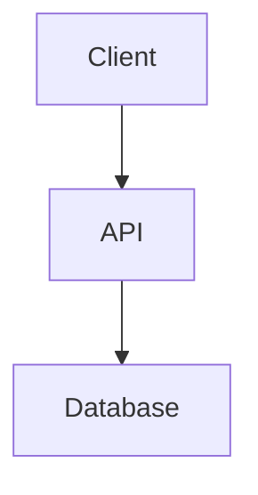

# Draw.io MCP Skill

This skill provides access to Draw.io diagramming capabilities through the Model Context Protocol (MCP). It allows you to generate diagrams programmatically using Mermaid, CSV, or XML, and open them directly in the Draw.io editor.

## Tools

### `open_drawio_mermaid`
Opens the Draw.io editor with a diagram generated from Mermaid.js syntax. Best for flowcharts, sequence diagrams, and class diagrams.

**Parameters:**
- `content` (string, required): The Mermaid diagram syntax.
- `lightbox` (boolean, optional): If true, opens in read-only lightbox mode. Default: `false`.
- `dark` (string, optional): Theme preference. Values: `"auto"`, `"true"`, `"false"`. Default: `"auto"`.

### `open_drawio_csv`
Opens the Draw.io editor with a diagram generated from CSV data. Best for organizational charts, tree structures, and simple network diagrams.

**Parameters:**
- `content` (string, required): The CSV content.
- `lightbox` (boolean, optional): Default: `false`.
- `dark` (string, optional): Default: `"auto"`.

### `open_drawio_xml`
Opens the Draw.io editor with native Draw.io/mxGraph XML content. Best for complex, custom diagrams or editing existing diagram XML.

**Parameters:**
- `content` (string, required): The Draw.io XML or a URL to an XML file.
- `lightbox` (boolean, optional): Default: `false`.
- `dark` (string, optional): Default: `"auto"`.

## Usage Guidelines

### When to use
- Use when the user requests a visual diagram (flowchart, architecture, org chart).
- Use `open_drawio_mermaid` for standard software diagrams (Sequence, Flowchart, State, Class).
- Use `open_drawio_csv` for hierarchical data like Org Charts.
- Use `open_drawio_xml` when precise control over layout is needed or when modifying existing XML.

### Examples

#### Mermaid Flowchart
```javascript
// Call open_drawio_mermaid
{
  "content": "graph TD\n A[Start] --> B{Decision}\n B -->|Yes| C[Action]\n B -->|No| D[End]",
  "dark": "auto"
}
```

#### CSV Org Chart
```javascript
// Call open_drawio_csv
{
  "content": "## Org Chart\nname,title,manager\nAlice,CEO,\nBob,CTO,Alice\nCharlie,CFO,Alice",
  "dark": "false"
}
```

## Setup (If not already configured)
If the MCP server is not running, you may need to start it or ask the user to configure it.
## Workflow Integration

### Enhancing Artifacts
You can use this skill to make artifacts (like `functional_spec`, `implementation_plan`, or `walkthrough`) more visual and understandable.
1. **Generate Mermaid**: Create a Mermaid diagram within the artifact using a `mermaid` code block. This provides an immediate visual in markdown viewers.
2. **Offer Editable Version**: Below the diagram, you can provide a call to `open_drawio_mermaid` with the same content, allowing the user to open and edit the diagram in a rich interface.

### Example: Functional Spec
```markdown
### System Architecture

> [!TIP]
> Use the `open_drawio_mermaid` tool to open this diagram in Draw.io for editing.
```

### Visualizing Complex Logic
For complex logic (e.g., state machines, offline sync flows), always prefer a diagram over text. Use `open_drawio_mermaid` to visualize the flow before implementing it.

