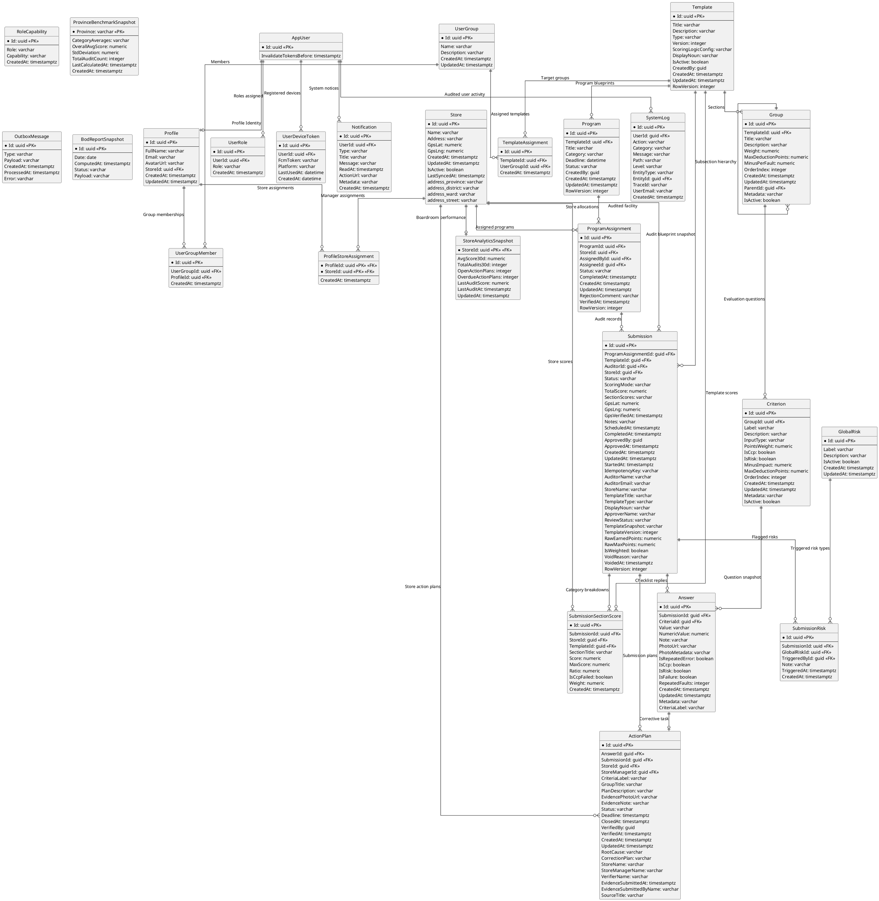

# Checkly System Entity-Relationship Diagram (PlantUML)

This document contains the PlantUML database ERD for the Checkly system, detailing all **24 database entities**, columns, keys, and their relationships.

## Rendered Diagram Image

![Checkly Database ERD (PlantUML)](https://www.plantuml.com/plantuml/png/jLhTRzis47_tNo7aiK200NihYgAEanH6azHpqkvne2L6vaA96aavzPRzxpj-I295wiD6zz8cnplU9tztfF99ICHbNT25U25bXJWg4afAB8yLJXYNUxROammdAU4fnOi5BYMHnsHPLTy4via_YoHvbwopzqbTaopvy67pvUD7e5rUmZ_hye0eoP34J-m5b-8AFpEEtoUI51ZK5fNyU_5lk-M6isT2yVYMjpMb3wY0JGw8ftl4WNPJ849TmlA0mAblt2C-Ij3jx7fhTbrn3FPbI-cRbIJVgYosqDch_D-oAOCLLwXLoRd63LZHALC2ArIX7Q7grr6LmUQjt4agbUMVEQkhSMtzR5nZaN9IISBA6UfcnbdRSO-BtLJ9jSnXp6rzpIu1tu9hV22fgUDp4dwR5bhM3Sc68Wa7ed1fTqX8s44Re-AY3F9DRAcTVRgqJylICiiu5i8bVQx47G85PLrWJb9BANENSceM0GF4CfNa0Cft3EeIbTR9nsEPnlYHCUoFYhC30HRNmcOj8qA2FJAszefu5gE31CQEH80xEeXB8KXU5h1YmnaMZOfgbzTt0QxuwphuamLcT9U87YL9nME9Ah5dZGap52mF-MCANB_-ahdPUc8IqMMT4Idq2Yabph6AojSAboelh8GYB8MtTC0yg_70gagTtb7hSvMrAsSSyOrDzXKkqts1-4il19j-CVIgUmNRvumVbs0xoh5NrieVH6aJ8jVaHvcfOuqCLiNYjc9rAVl-hn1DQnelzybKF-6YKhBZn_M9I3e7LP-WIxk_VyTSQ9REOkKrAVCxbfDqnSfdadlx4W7c71_0JvSSExNMjIle8ZbOV1OQRDbhO68NcndTfWbVYB1pG_Ox9ldUWxbxzECQPxKfU0Pc2M-LbBNOO7wBQkg9VUKP87sPuHzkk4-FoGPny5yvb7iEtME9G0IDvwMBteeJ2QQnYVuqq1tlq0xJ6U5RbrKj-sLdeXP6TYrMQUNMq5fiYNXnAJgyww92wGav-LcXFpN4JVK5RUBaQXsPKwQxHRqhY12JcGRKp66SxumDQymrq5_HyCTukD2sepuPoTe3NWiyzoppQaM3QmZ5MATQqq-UIe02g4AUIIp73qpYdbrxg2mQHMy6uS3HKe4B3pGX3_uQqkmkC5A9Z-eM5fsVCaWHk52cno_O6-1jXeB9pf23Iv7EMv-voNy0dkr2xwGFz0iRYi2OBRHN_1hMHhDzq-TZQv5UjaMlDuYNE0iX0PO0CqBwsi8IpbpK-Sv8jiL8-DYcgATthMKfNgUk9TsH3K-EnMqKhdn7jFR2-M3SilJEILNZ7Xv3I5dl_gjfSS3RuahNwmtdZFjmFOdVQt4BXLPpRrHeDjGzK_nyZ6v2rcjQCOXqWUMK7DLpG6yOFgtQu5m5m0T56z2sQY8D-gYAir_5OSETx1tTM3yU35FK4Rz62dcmCm3v7fKmcFFXwW_c3zqTW_WfomScavi3d5wu9CIAlrdh7vGGcQunojJxLm3fb8bOUJQDn-aBmxted86PmNsZ5lw33kCSjucS17at0VqrQsj0RmAcyosZfWKiLyT0CwjvscykphnFsGvHXIZZnJXxDXs-jPnnAUrAVTh2CUpel8nSMZZ98IigTk7Hw1Thotp6jTFEWZ_jSjNSkED7ntcv2a_O_t-F30RVMNFo2EhxPBDlaxFesgm1UMJQF2CY-4y32R2hSZboo4-E8nGWoANwVUISHy_-y1XKqJqM0b39dnXHRFhMhlL0FJuPJ5sUZaBYuexbynpgNOhIu5axSWuYNcsGt7lFlFZW8zgDjguVC4EDp1qSfRh4EbPbS33pJqRZQortx8SrU08S-dT-TAGCPRFU-E64fQ0ZsaNCp1asXoi64th5kEoz1GwOTusa1HvxikgXUrRl50P-W0dDrwstjyjBzjP-cNgVN3G_mhLCctdXy_xJVHK2PlM_I925YoYh-rb1IU2SG7q2nYUPNX4NY-uxZ2FdVX01EVCJC3Vs3REQhGeZi2SL29dl1rPau3bSAJ4ZX7L8KKE5mz96YIVhw7qRUWC7oIk6UCOPAv8AS_N11C7KSR5eNrAjQkEOqcI041HuOUlMwvqmBCaUHX-LzcEFjtjB0_wR0zot30Z-LKCjcRtxwYDlGo3xX7YEPPAhpMEvZ4ir7IQHTZcYh-defYZrZpku5bQSD7dHD9yxcX9AcS7uI2c4GgrjbLdjT3byTWFdfKf9gfU912PNnhE8Gp7crgD4s8BecHWH0jEUKQg_Tm9pjsubx7KTk5TxdBvGE6zWKqM92dANzu3xDvjwrv9Wyu5xfr9c6qMo0v1yoTXh4ErXMSCczDlOMDpwSYrd8sgziIVEkGig0-sbue0JYSHBD7IUWBDUgSz4FNTwpARKpAbhs4V2fqTkaBkb26RUBE7mkphGtOrXKAGTaxLGelwGGGJOwuqsoZuz5YGbaDC8UpSrE5LMAmRbqa6Nsk8JBhEweFy1)

---

## PlantUML Code

You can modify or rebuild this diagram using the PlantUML source code below:

