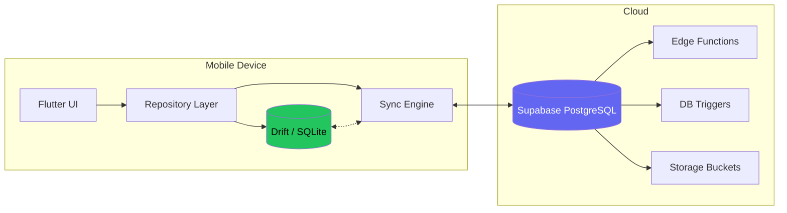
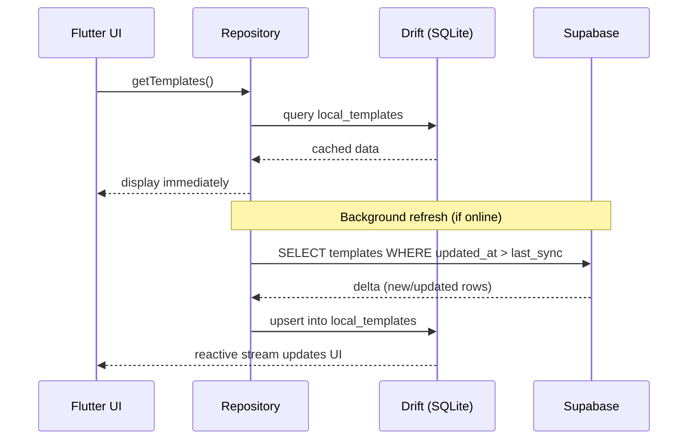
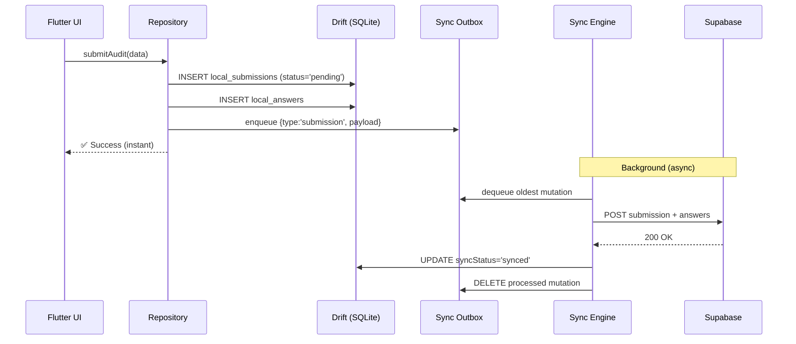
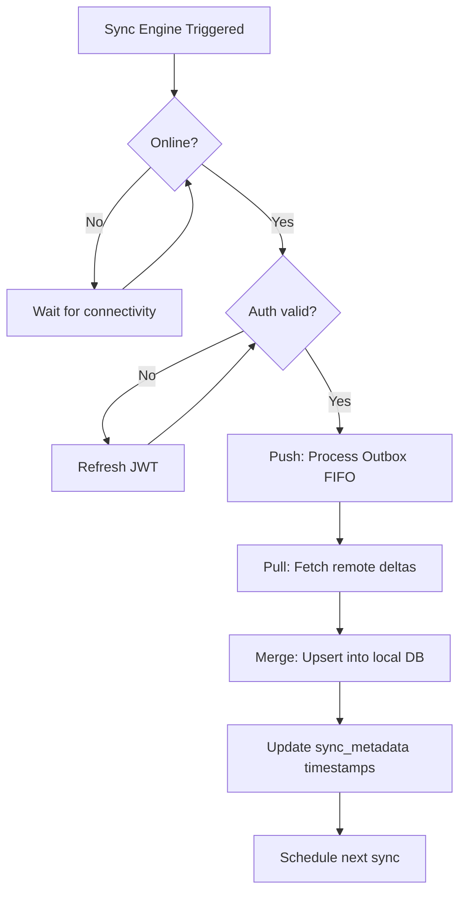
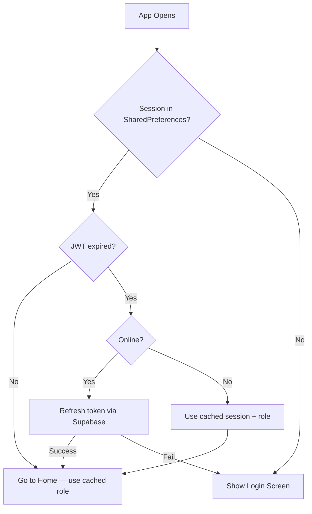

# UDAT Flutter — Backend & Database Architecture Plan

> **Author**: Scout (Lead Architect) — applying `backend-architect` + `database-design` skills
> **Date**: 2026-03-10
> **Status**: Architecture Brief — Awaiting Decision
> **Scope**: This document covers the **data layer, backend integration, and sync architecture** for the greenfield Flutter app.

## Context & References

| Source | Skill/Knowledge |
|--------|------|
| Backend Architect Skill | [SKILL.md](file:///c:/Users/HP/Documents/GitHub/checkly-smart/.agent/skills/backend-architect/SKILL.md) |
| Database Design Skill | [SKILL.md](file:///c:/Users/HP/Documents/GitHub/checkly-smart/.agent/skills/database-design/SKILL.md) |
| Current Schema | GEMINI.md §4 (Database Schema) |
| Offline Architecture | [overview.md](file:///C:/Users/HP/.gemini/antigravity/knowledge/offline_architecture_and_sync/artifacts/overview.md) |
| Infrastructure Standards | [infrastructure_standards.md](file:///C:/Users/HP/.gemini/antigravity/knowledge/infrastructure_and_security_standards/artifacts/infrastructure_standards.md) |

---

## 1. The Big Picture: Local-First Architecture

The fundamental shift from the PWA to Flutter is the **data gravity** change:

```
PWA (Current):         Supabase is the PRIMARY data source. IndexedDB is a cache.
Flutter (Target):      SQLite is the PRIMARY data source. Supabase is the sync target.
```



> [!IMPORTANT]
> **Core Principle**: The app reads from and writes to the **local SQLite database first**. The sync engine reconciles with Supabase in the background. The user never waits for the network.

---

## 2. Local Database Design (Drift / SQLite)

### 2.1 Technology Choice: **Drift**

| Option | Verdict |
|--------|---------|
| **Drift** ⭐ | Type-safe SQLite ORM for Dart. Reactive streams, migrations, compile-time SQL verification. Best for complex schemas |
| **Isar** | NoSQL-style. Fast for simple models but lacks relational joins. Discontinued by maintainer in 2024 |
| **Hive** | Key-value store. Too simple for relational audit data |
| **sqflite** | Raw SQLite. No type safety, no reactive streams. Too low-level |

### 2.2 Local Schema — Table-by-Table Design

The local DB mirrors the Supabase schema but with **offline-first adaptations** (sync metadata columns, conflict markers).

#### Sync Metadata Columns (Added to Every Synced Table)

Every table that syncs with Supabase gets these extra columns:

```dart
// Added to every synced Drift table
TextColumn get syncStatus => text().withDefault(const Constant('pending'))(); 
// Values: 'synced', 'pending', 'conflict', 'error'

DateTimeColumn get localUpdatedAt => dateTime().withDefault(currentDateAndTime)();
DateTimeColumn get remoteUpdatedAt => dateTime().nullable()();
BoolColumn get isDeleted => boolean().withDefault(const Constant(false))(); // Soft delete
```

#### Table Mapping: Supabase → Local SQLite

| # | Supabase Table | Local Drift Table | Sync Direction | Local Storage | Notes |
|---|---------------|-------------------|----------------|---------------|-------|
| 1 | `profiles` | `local_profiles` | ⬇️ Pull only | Current user + team profiles | Read-only locally. Pulled from Supabase on login |
| 2 | `user_roles` | `local_user_roles` | ⬇️ Pull only | Current user's role | Used for route guards. Never written locally |
| 3 | `stores` | `local_stores` | ⬇️ Pull only | All active stores | Cached for offline store picker. Includes GPS coords |
| 4 | `templates` | `local_templates` | ⬇️ Pull only | All active templates | Cached with full group + criteria hierarchy |
| 5 | `groups` | `local_groups` | ⬇️ Pull only | Template sections | Part of template cache |
| 6 | `criteria` | `local_criteria` | ⬇️ Pull only | Audit questions + weights | Part of template cache |
| 7 | `submissions` | `local_submissions` | ⬆️⬇️ Bidirectional | All user's submissions | Created locally, synced up. Also pulled for history |
| 8 | `answers` | `local_answers` | ⬆️ Push only | Answers per submission | Created locally during audit, pushed with submission |
| 9 | `action_plans` | `local_action_plans` | ⬆️⬇️ Bidirectional | User's action plans | SM updates status locally → synced. Also pulled |
| 10 | `notifications` | `local_notifications` | ⬇️ Pull + local create | User's notifications | Pulled from realtime channel. Read status updated locally |
| 11 | — | `local_drafts` | 🔒 Local only | Auto-saved in-progress audits | Never synced. Deleted after submission |
| 12 | — | `sync_outbox` | 🔒 Local only | Mutation queue (FIFO) | Pending uploads. Same pattern as current Dexie outbox |
| 13 | — | `local_photos` | ⬆️ Push only | Binary blobs pending upload | Stored as file paths (not blobs in SQLite) |
| 14 | — | `sync_metadata` | 🔒 Local only | Last sync timestamps per table | Tracks remote cursor for incremental sync |

### 2.3 Drift Schema Definition (Core Tables)

```dart
// Template cache (pull-only)
class LocalTemplates extends Table {
  TextColumn get id => text()();                  // UUID from Supabase
  TextColumn get title => text()();
  TextColumn get scoringLogicConfig => text()();  // JSON blob
  BoolColumn get isActive => boolean()();
  DateTimeColumn get remoteUpdatedAt => dateTime()();
  
  @override
  Set<Column> get primaryKey => {id};
}

// Submissions (bidirectional sync)
class LocalSubmissions extends Table {
  TextColumn get id => text()();                  // Local UUID (generated client-side)
  TextColumn get templateId => text()();
  TextColumn get storeId => text()();
  TextColumn get auditorId => text()();
  RealColumn get totalScore => real().nullable()();
  TextColumn get status => text()();              // 'draft', 'completed', 'synced'
  TextColumn get gpsLatitude => text().nullable()();
  TextColumn get gpsLongitude => text().nullable()();
  // Snapshot fields (denormalized for offline display)
  TextColumn get auditorName => text()();
  TextColumn get storeName => text()();
  TextColumn get templateTitle => text()();
  // Sync metadata
  TextColumn get syncStatus => text().withDefault(const Constant('pending'))();
  DateTimeColumn get localCreatedAt => dateTime().withDefault(currentDateAndTime)();
  DateTimeColumn get remoteUpdatedAt => dateTime().nullable()();
  
  @override
  Set<Column> get primaryKey => {id};
}

// Sync Outbox (local only — mutation queue)
class SyncOutbox extends Table {
  IntColumn get id => integer().autoIncrement()();
  TextColumn get entityType => text()();          // 'submission', 'answer', 'action_plan', 'photo'
  TextColumn get entityId => text()();            // UUID of the entity
  TextColumn get operation => text()();           // 'insert', 'update', 'delete'
  TextColumn get payload => text()();             // JSON of the mutation
  IntColumn get retryCount => integer().withDefault(const Constant(0))();
  TextColumn get status => text().withDefault(const Constant('pending'))(); // 'pending', 'processing', 'failed', 'dead'
  DateTimeColumn get createdAt => dateTime().withDefault(currentDateAndTime)();
  TextColumn get errorMessage => text().nullable()();
}
```

---

## 3. Data Flow Patterns

### 3.1 Read Path (Local-First)



**Key Design**: UI always gets instant data from SQLite. Remote fetch is a **background delta sync**, not a blocking call.

### 3.2 Write Path (Outbox Pattern)



### 3.3 Sync Path (Incremental Delta Sync)



---

## 4. Conflict Resolution Strategy

Since field auditors are the primary users, **conflicts are rare but must be handled**:

| Scenario | Strategy | Rationale |
|----------|----------|-----------|
| **Submission created offline** | **Last-Write-Wins (client)** | Submissions are created once. No concurrent edits |
| **Action Plan status updated by two users** | **Server-Wins** | SM and AM may both update. Server state is authoritative |
| **Template updated remotely while cached** | **Server-Wins** | Templates are admin-managed. Always take the latest |
| **Profile/Store updated remotely** | **Server-Wins** | Read-only data. Always overwrite local cache |
| **Notification read status** | **Client-Wins** | Local read state is user's truth |

```dart
// Conflict resolution in Sync Engine
Future<void> mergeRemoteData<T>(
  String tableName,
  List<T> remoteRows,
  DateTime Function(T) getRemoteUpdatedAt,
  String Function(T) getId,
) async {
  for (final row in remoteRows) {
    final local = await db.getById(tableName, getId(row));
    if (local == null) {
      await db.insert(tableName, row); // New record
    } else if (local.syncStatus == 'pending') {
      // Local has unsynced changes — mark conflict for review
      await db.markConflict(tableName, getId(row), row);
    } else {
      await db.upsert(tableName, row); // Server wins
    }
  }
}
```

---

## 5. Supabase Backend — What Changes vs What Stays

### 5.1 Zero Changes (100% Reusable)

| Component | Status | Reason |
|-----------|--------|--------|
| PostgreSQL schema (all tables) | ✅ Unchanged | Flutter reads/writes the same tables |
| RLS policies (all 38) | ✅ Unchanged | `supabase_flutter` sends the same JWT. RLS works identically |
| Edge Functions (`admin-api`, `finalize_audit_workflow`, `verify-score`) | ✅ Unchanged | Called via HTTP. Language-agnostic |
| DB Triggers (`handle_submission_completion`, `handle_action_plan_status_change`) | ✅ Unchanged | Server-side. Fires on INSERT/UPDATE regardless of client |
| pg_cron jobs (deadline reminders, schedule reminders) | ✅ Unchanged | Server-side scheduled. No client dependency |
| Storage buckets (`audit-photos`, `action-plan-evidence`) | ✅ Unchanged | `supabase_flutter` Storage API is identical to JS |

### 5.2 New Components Needed

| Component | Why | Design |
|-----------|-----|--------|
| **Sync timestamp RPC** | Incremental sync needs to fetch "what changed since X" | `get_changes_since(table_name, last_sync_at)` — new RPC function |
| **Push notification trigger** | FCM/APNs needs a server-side trigger | Edge Function or DB trigger that calls FCM API on notification INSERT |
| **Batch submission endpoint** | Offline may queue 5-10 audits. One-by-one sync is slow | New RPC or Edge Function for batch INSERT |

### 5.3 New Supabase RPC: `get_changes_since`

```sql
-- New RPC for incremental delta sync
CREATE OR REPLACE FUNCTION get_changes_since(
  p_table_name TEXT,
  p_since TIMESTAMPTZ
)
RETURNS JSONB
LANGUAGE plpgsql
SECURITY INVOKER  -- Respects RLS
AS $$
DECLARE
  result JSONB;
BEGIN
  EXECUTE format(
    'SELECT jsonb_agg(row_to_json(t)) FROM %I t WHERE updated_at > $1',
    p_table_name
  ) INTO result USING p_since;
  
  RETURN COALESCE(result, '[]'::jsonb);
END;
$$;
```

> [!WARNING]
> This RPC uses dynamic SQL. It needs an allowlist of table names to prevent SQL injection. A safer approach is one RPC per entity (e.g., `get_template_changes_since`, `get_submission_changes_since`).

---

## 6. Auth Architecture

### 6.1 Session Persistence



### 6.2 Role-Based Guards

```dart
// GoRouter guard — reads role from local DB
GoRoute(
  path: '/admin',
  redirect: (context, state) {
    final role = ref.read(currentUserRoleProvider);
    if (role != 'admin') return '/unauthorized';
    return null;
  },
  builder: (context, state) => const AdminDashboard(),
),
```

### 6.3 Key Auth Decisions

| Decision | Choice | Rationale |
|----------|--------|-----------|
| Session storage | `supabase_flutter` default (SharedPreferences) | Built-in, battle-tested, handles refresh tokens |
| Role caching | Drift `local_user_roles` table | Available offline. Synced on login |
| JWT refresh | Supabase SDK handles automatically | No custom logic needed |
| Offline auth | Use cached session, skip refresh | Auditors often start work offline. Don't block them |

---

## 7. Photo Storage Architecture

The PWA stores photos as IndexedDB blobs. Flutter has much better options:

### 7.1 Strategy: File System + SQLite Metadata

```
photos/
├── pending/                    # Awaiting upload
│   ├── {submission_id}/
│   │   ├── {answer_id}_1.jpg
│   │   └── {answer_id}_2.jpg
├── cached/                     # Downloaded from Supabase (display cache)
│   └── {photo_path}.jpg
```

```dart
// Photo metadata in Drift (NOT the blob itself)
class LocalPhotos extends Table {
  IntColumn get id => integer().autoIncrement()();
  TextColumn get submissionId => text()();
  TextColumn get answerId => text()();
  TextColumn get localPath => text()();           // File system path
  TextColumn get remotePath => text().nullable()(); // Supabase storage path (null until synced)
  TextColumn get syncStatus => text().withDefault(const Constant('pending'))();
  IntColumn get fileSizeBytes => integer()();
  DateTimeColumn get createdAt => dateTime().withDefault(currentDateAndTime)();
}
```

> [!TIP]
> **Why not store blobs in SQLite?** SQLite performance degrades with large blobs (>1MB). The file system is purpose-built for binary data. SQLite tracks metadata + sync status only.

### 7.2 Storage Quota Management

```dart
class StorageGuardian {
  static const int maxPendingPhotosBytes = 500 * 1024 * 1024; // 500MB
  
  Future<bool> canStorePhoto(int fileSizeBytes) async {
    final currentUsage = await db.getTotalPendingPhotoSize();
    return (currentUsage + fileSizeBytes) < maxPendingPhotosBytes;
  }
  
  Future<void> cleanupSyncedPhotos() async {
    final synced = await db.getSyncedPhotos();
    for (final photo in synced) {
      await File(photo.localPath).delete();
      await db.deletePhotoMetadata(photo.id);
    }
  }
}
```

---

## 8. Background Sync Engine

### 8.1 Architecture

```dart
class SyncEngine {
  final Drift db;
  final SupabaseClient supabase;
  final ConnectivityMonitor connectivity;
  
  // Sync priorities (FIFO within each tier)
  static const syncOrder = [
    'submission',    // Most critical — audit data
    'answer',        // Part of submission
    'photo',         // Binary — large but important
    'action_plan',   // Status updates
  ];
  
  Future<void> runSyncCycle() async {
    if (!await connectivity.isOnline()) return;
    if (!await _hasValidAuth()) return;
    
    // Phase 1: Push local changes (outbox)
    await _processOutbox();
    
    // Phase 2: Pull remote changes (delta sync)
    await _pullRemoteChanges();
    
    // Phase 3: Cleanup synced photos
    await _cleanupSyncedAssets();
  }
}
```

### 8.2 Background Execution

| Platform | Method | Constraints |
|----------|--------|------------|
| **Android** | `workmanager` plugin → `WorkManager` API | Minimum 15 min interval. OS may defer |
| **iOS** | `workmanager` plugin → `BGTaskScheduler` | Minimum 15 min. iOS throttles aggressively |
| **Foreground** | `Timer.periodic` + `connectivity_plus` listener | Immediate sync when app is in use |

```dart
// Register background sync (main.dart)
Workmanager().initialize(callbackDispatcher);
Workmanager().registerPeriodicTask(
  'udat-sync',
  'backgroundSync',
  frequency: Duration(minutes: 15),
  constraints: Constraints(
    networkType: NetworkType.connected,
    requiresBatteryNotLow: true,
  ),
);
```

---

## 9. Security Model Translation

### 9.1 RLS → Local Guards

RLS protects data at the Supabase level. Locally, you need **application-level guards**:

| Supabase RLS Policy | Local Guard Equivalent |
|---------------------|----------------------|
| `auth.uid() = user_id` | Repository filters by local `currentUserId` |
| `user_roles.role = 'admin'` | GoRouter redirect + Repository-level role check |
| `profiles.store_id = submissions.store_id` | Repository joins on `store_id` from cached profile |

> [!CAUTION]
> **Local SQLite has no RLS.** If the device is compromised, all local data is accessible. Mitigations:
> - Encrypt the SQLite database using `sqlcipher_flutter_libs` (AES-256)
> - Clear local data on logout
> - Use device biometric lock before app access

### 9.2 SQLite Encryption

```dart
// Use SQLCipher for at-rest encryption
import 'package:drift/native.dart';
import 'package:sqlcipher_flutter_libs/sqlcipher_flutter_libs.dart';

LazyDatabase openConnection() {
  return LazyDatabase(() async {
    final dbFolder = await getApplicationDocumentsDirectory();
    final file = File(path.join(dbFolder.path, 'udat.db'));
    return NativeDatabase(file, setup: (db) {
      db.execute("PRAGMA key = '\$encryptionKey'");
    });
  });
}
```

---

## 10. Things You Might Have Missed

Here are gaps I identified that you should consider:

| # | Gap | Impact | Recommendation |
|---|-----|--------|----------------|
| 1 | **Database migrations (local)** | Drift schema will evolve. Users have existing local data | Drift has built-in migration support. Plan version strategy from Day 1 |
| 2 | **Multi-device sync** | If an auditor uses two devices, which local DB is authoritative? | Server-wins for pull-only tables. Outbox is per-device. Submissions are immutable once synced |
| 3 | **Initial data seeding** | First app launch needs all templates, stores, profiles downloaded | Build a "first sync" flow with progress indicator. Estimate 2-5 MB initial download |
| 4 | **Realtime channels** | PWA uses Supabase Realtime for notifications and live updates | `supabase_flutter` supports Realtime. But consider: do you need it if you have push notifications? |
| 5 | **Edge Function invocation** | `finalize_audit_workflow` is called post-submission. Must work the same way | `supabase.functions.invoke('finalize_audit_workflow', body: {...})` — identical API |
| 6 | **Rate limiting** | PWA has DB-backed rate limits (`rate_limits` table) | Same table. `supabase_flutter` sends same JWT. Rate limit checks work identically |
| 7 | **Audit trail / system_logs** | PWA writes to `system_logs` via Logger service | Decision: log locally (SQLite) + batch push? Or log directly to Supabase when online? |
| 8 | **Deep links / URL scheme** | PWA uses web URLs. Flutter needs a custom URL scheme for notifications | Register `udat://` scheme. Map push notification payloads to GoRouter paths |
| 9 | **App size budget** | Flutter apps are ~15-25MB. SQLite + photos can grow | Monitor with `StorageGuardian`. Offer "clear cache" in settings |
| 10 | **Concurrent PWA + Flutter** | During transition, both apps hit the same Supabase backend | No conflict — both use same auth + RLS. Data is consistent |
| 11 | **`verify-score` Edge Function** | Server-side score re-computation. Currently called via `http` extension | Flutter calls it the same way — just an HTTP POST. No change |
| 12 | **AI Assistant** | SSE streaming to Gemini Flash via Edge Function | Flutter's `http` package supports SSE. But building the Generative UI widgets is significant Flutter work. Recommend Phase 2 |

---

## 11. Recommended Architecture Layers

```
┌──────────────────────────────────────────────────┐
│                   Flutter UI                      │
│         (Screens, Widgets, State via Riverpod)    │
├──────────────────────────────────────────────────┤
│                Repository Layer                   │
│   (Data access abstraction — local-first reads)   │
│   ┌─────────────┐  ┌──────────────────────┐      │
│   │ Local Source │  │   Remote Source       │      │
│   │ (Drift/SQL) │  │ (Supabase Client)     │      │
│   └─────────────┘  └──────────────────────┘      │
├──────────────────────────────────────────────────┤
│               Sync Engine Layer                   │
│   (Outbox processing, delta pull, conflict merge) │
├──────────────────────────────────────────────────┤
│             Core Services Layer                   │
│   (Auth, Scoring, GPS, Photo, Connectivity)       │
├──────────────────────────────────────────────────┤
│         Platform Layer (Native APIs)              │
│   (Camera, File System, Background Tasks, FCM)    │
└──────────────────────────────────────────────────┘
```

---

## 12. Summary: What's New vs What's Inherited

| Aspect | Inherited from PWA (same logic) | New for Flutter |
|--------|---------------------------------|-----------------|
| **Auth** | Same Supabase Auth, same JWT | Session in SharedPreferences, biometric lock |
| **Schema** | Same PostgreSQL tables + RLS | Local SQLite mirror via Drift |
| **Scoring Engine** | Same algorithm | Dart port (pure functions) |
| **Offline Outbox** | Same FIFO pattern | Drift table instead of Dexie |
| **Sync Engine** | Same heartbeat + retry logic | Dart Isolate + `workmanager` for background |
| **Photo Upload** | Same Supabase Storage buckets | File system storage instead of IndexedDB blobs |
| **Edge Functions** | Same server-side functions | Called via `supabase.functions.invoke()` |
| **DB Triggers** | Same triggers | No change (server-side) |
| **Push Notifications** | ❌ PWA had unreliable Web Push | ✅ Native FCM/APNs — new capability |
| **DB Encryption** | ❌ IndexedDB has no encryption | ✅ SQLCipher AES-256 — new capability |
| **Background Sync** | ❌ iOS kills Service Workers | ✅ Native `BGTaskScheduler` — new capability |
