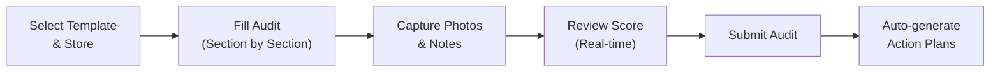
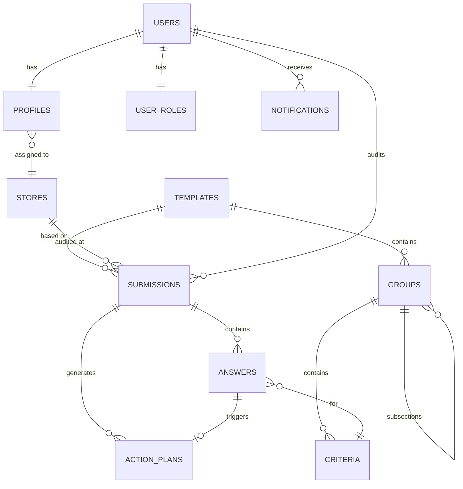
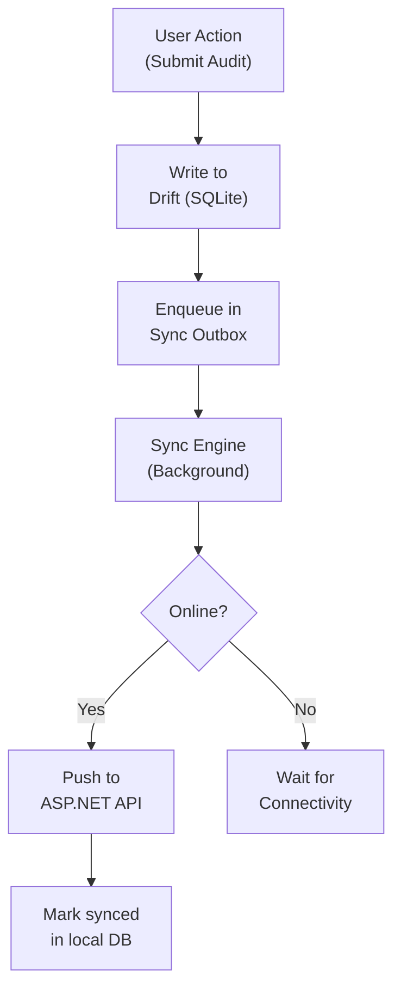

# Product Requirements Document — Checkly Mobile

> **Version**: 2.0
> **Date**: 2026-03-12
> **Author**: Scout (Lead Architect)
> **Status**: All Batches Implemented — Entering UAT
> **Repository**: [github.com/andyandsmoothies-ship-it/Checkly](https://github.com/andyandsmoothies-ship-it/Checkly)

---

## 1. Executive Summary

**Checkly** is a native mobile application for internal quality auditing, built with Flutter and backed by a self-hosted ASP.NET Core API. It replaces the existing UDAT Progressive Web App (React + Supabase) with a faster, offline-capable native experience — deployed internally via APK sideloading (Android) and TestFlight (iOS), with zero app store dependency.

### Why Rebuild?

| Pain Point (PWA) | Solution (Native) |
|-------------------|-------------------|
| Browser limitations on mobile (no background sync, limited storage) | Native background execution, unlimited local storage |
| Supabase dependency (cloud, recurring cost, vendor lock-in) | Self-hosted on company Windows Server — zero cloud cost |
| No push notifications (PWA has limited support) | Native push via SignalR + optional FCM |
| Camera/GPS unreliable in some mobile browsers | Direct hardware access via Flutter plugins |
| App store publishing required for iOS | Internal distribution via APK/TestFlight |

---

## 2. Target Users & Personas

| Persona | Role | Key Actions | Device |
|---------|------|-------------|--------|
| **Field Auditor** | `auditor` | Execute audits at stores, capture photos, submit findings | Android phone (primary) |
| **Store Manager** (SM) | `store_manager` | View audit results for their store, submit corrective action plans with evidence | Android/iOS phone |
| **Area Manager** (AM) | `area_manager` | Review audits across multiple stores in their region, verify action plan completion | Android/iOS phone or tablet |
| **Administrator** | `admin` | Manage templates, users, stores. View all data. Approve/reject audits | Android/iOS tablet or desktop (web dashboard later) |

> [!NOTE]
> **Primary user**: Field Auditor on Android. The app is designed mobile-first for this persona. All other personas benefit from the same app but may use tablets or a future web dashboard.

---

## 3. Core Features (MVP — Phase 0-2)

### 3.1 Authentication & Authorization

| Requirement | Detail |
|-------------|--------|
| **Login** | Email + password → JWT token |
| **Offline login** | Cached session allows offline access with last-known role |
| **Role-based access** | 4 roles with hierarchical permissions (see §2) |
| **Data isolation** | Store managers see only their store's data; area managers see their region |
| **Session refresh** | Automatic JWT refresh; graceful offline fallback |

### 3.2 Audit Execution (The Core Flow)



| Requirement | Detail |
|-------------|--------|
| **Template selection** | Browse available templates, filtered by type (QC / Training / General) |
| **Store selection** | List all active stores with GPS verification |
| **Section-by-section form** | Collapsible sections matching template → groups → criteria hierarchy |
| **Criteria input** | Pass/Fail, Numeric (fault count), N/A — per criteria type |
| **Photo capture** | Attach photo evidence to any criteria answer |
| **Real-time scoring** | Score calculated locally as auditor fills in answers |
| **GPS verification** | Capture lat/lng at submission time to prove on-site presence |
| **Draft auto-save** | In-progress audits saved locally, resumable after app restart |
| **Offline submission** | Full audit (answers + photos) queued locally if offline |

### 3.3 Scoring Engine

| Requirement | Detail |
|-------------|--------|
| **Model** | Unified Deduction (Penalty-First): start at 100%, deduct for faults |
| **Formula** | `Final = Σ(section_after / section_before × section_weight) × 100` |
| **CCP trigger** | Critical Control Point failure → entire section score = 0% |
| **RISK trigger** | RISK item failure → entire audit score = 0% |
| **Weighted density** | Optional: sections weighted by percentage (must sum to 100%) |
| **Checklist fallback** | No weights defined → `100 - Σ(raw deductions)` |
| **C3 Progressive repeat** | Optional per template: `deduction = repeatedFaults² × minusPerFault` (quadratic escalation) |
| **C4 minus_impact** | Per-criteria override: uses `minus_impact` field instead of `points_weight` for deduction |
| **Server verification** | Server recalculates score on submission; configurable mode (enforce/observe) via `appsettings.json` |
| **Dart/C# lockstep** | Scoring engine implemented identically in both `scoring_engine.dart` and `ScoringVerifier.cs` |

### 3.4 Action Plans (Corrective Actions)

| Requirement | Detail |
|-------------|--------|
| **Auto-generation (S1)** | Created automatically for each failed criteria on submission. Snapshots criteria label, group, store name, SM |
| **Lifecycle** | `open` → `in_progress` → `pending_verify` → `closed` / `overdue` |
| **Store Manager response** | SM provides root cause, correction plan, and evidence photo |
| **Verification** | Admin/AM verifies completion, marks as closed |
| **Deadline tracking** | Configurable per template (default 7 days), with overdue status |
| **Deadline reminders (S6)** | Background service sends notification when AP is within 48h of deadline |
| **Schedule reminders (S7)** | Background service notifies auditors of tomorrow's scheduled audits |

### 3.5 Notifications

| Requirement | Detail |
|-------------|--------|
| **Real-time** | SignalR push when audit submitted, action plan status changes |
| **In-app inbox** | List of notifications with read/unread status, bell icon badge |
| **S2 AP status change** | Notification to relevant users when AP status changes (open → in_progress, etc.) |
| **S3 Audit submitted** | Notification to store manager when audit is submitted for their store |
| **Types** | New audit for store, AP status change, AP deadline approaching, audit approved/rejected |

### 3.6 Reference Data Management (Admin)

| Requirement | Detail |
|-------------|--------|
| **Templates** | CRUD with nested sections (groups) and criteria. **Soft-delete** (`IsActive = false`) |
| **Groups / Criteria** | Managed within templates. **Soft-delete** — historical submissions retain answers linked to deactivated criteria |
| **Stores** | CRUD with address, GPS coordinates, area assignment (FK to `areas`). **Soft-delete** (`IsActive = false`) |
| **Users** | Create users, assign roles, link to stores/areas. **Ban** (LockoutEnd) instead of delete |
| **Submissions** | **Never delete** — core business record, status transitions only |
| **Action Plans** | **Never delete** — workflow record with evidence, status transitions only |
| **Notifications** | Hard-delete OK — auto-purged after 90-day retention |
| **System Logs** | Hard-delete OK — auto-purged after 90-day retention |

---

## 4. Data Model

### 4.1 Entity Relationship Summary

Full ERD with column details: see [Architecture Decision](file:///C:/Users/HP/.gemini/antigravity/brain/a5535011-f330-4ba9-91c5-fd83a11be81b/analysis_architecture_decision.md#6-entity-relationship-diagram-from-live-supabase-schema)



### 4.2 Core Entities (9 tables)

| Entity | Rows (Supabase) | Key Fields |
|--------|-----------------|------------|
| `profiles` | 45 | full_name, email, store_id, area_id (FK → areas) |
| `user_roles` | 43 | user_id, role (enum: admin/auditor/SM/AM) |
| `stores` | 37 | name, address, area_id (FK → areas), gps_lat/lng, is_active |
| `templates` | 16 | title, type, scoring_logic_config (JSONB), version |
| `groups` | 107 | template_id, parent_id (self-ref), title, weight, order_index |
| `criteria` | 98 | group_id, label, input_type, is_ccp, is_risk, points_weight |
| `submissions` | 62 | template_id, store_id, auditor_id, total_score, status, GPS, snapshots |
| `answers` | 55 | submission_id, criteria_id, value, numeric_value, photo_url |
| `action_plans` | 55 | submission_id, answer_id, store_id, status, deadline |
| `areas` | — | name, code (unique), is_active |
| `notifications` | 163 | user_id, type, title, message, read_at |

### 4.3 Snapshot Fields

Submissions and action plans store **denormalized snapshots** of names/titles at creation time. This ensures historical accuracy when stores rename or users change roles:

- `submissions.auditor_name`, `store_name`, `template_title`
- `action_plans.criteria_label`, `group_title`, `store_name`, `store_manager_name`

---

## 5. Technical Architecture

### 5.1 Stack

| Layer | Technology | Version |
|-------|-----------|---------|
| Mobile | Flutter | 3.41.4 (Dart 3.11.1) |
| State Management | get_it + watch_it + command_it (PFA) | Latest |
| Local DB (Mobile) | Drift (SQLite) | Latest |
| Navigation | GoRouter | Latest |
| Backend API | ASP.NET Core 10 | .NET 10 |
| Architecture | **Vertical Slice Architecture** (Raw Handlers) | — |
| Server DB | PostgreSQL | 18.3 |
| ORM | Entity Framework Core 10 | Latest |
| Auth | ASP.NET Identity + JWT Bearer | Built-in |
| Real-time | SignalR | Built-in |
| File Storage | Local file system | — |

### 5.2 Architecture Pattern

**Vertical Slice Architecture** — single project, organized by feature:

```
server/
  Features/
    Auth/           → Login.cs, Register.cs
    Templates/      → ListTemplates.cs, CreateTemplate.cs, DeleteTemplate.cs, DeleteGroup.cs, DeleteCriterion.cs
    Submissions/    → CreateSubmission.cs, GetSubmission.cs, ReviewSubmission.cs
    ActionPlans/    → ListActionPlans.cs, CreateActionPlan.cs, UpdateActionPlan.cs
    Photos/         → UploadPhoto.cs, GetPhoto.cs
    Notifications/  → ListNotifications.cs, MarkRead.cs
    Admin/          → ListUsers.cs, UpdateUser.cs, BanUser.cs, TransferStoreManager.cs, ListSystemLogs.cs
    Analytics/      → GetAnalytics.cs
    Stores/         → ListStores.cs, GetStoreDashboard.cs, DeleteStore.cs
    Sync/           → SyncEndpoints.cs (delta sync per entity)
  Common/
    Persistence/    → AppDbContext.cs, entity configs
    Auth/           → JwtService.cs, authorization policies
    Scoring/        → ScoringVerifier.cs
    Services/       → ReminderService.cs (IHostedService — deadline + schedule reminders + 90-day data retention cleanup)
  Program.cs
```

### 5.3 Client-Server Communication

| Pattern | Use Case |
|---------|----------|
| **REST API** (Dio) | All CRUD operations, auth, sync |
| **SignalR** (signalr_netcore) | Real-time notifications |
| **Delta Sync** (`?since=timestamp`) | Incremental data pull for offline cache |
| **Outbox Pattern** | Offline writes queued locally, pushed when online |

### 5.4 Offline Architecture



---

## 6. Access Control Matrix

| Action | Admin | Auditor | Store Manager | Area Manager |
|--------|:-----:|:-------:|:-------------:|:------------:|
| Create/edit templates | ✅ | ❌ | ❌ | ❌ |
| Create/edit stores | ✅ | ❌ | ❌ | ❌ |
| Manage users | ✅ | ❌ | ❌ | ❌ |
| Execute audits | ✅ | ✅ | ❌ | ❌ |
| View own submissions | ✅ | ✅ | ❌ | ❌ |
| View store's submissions | ✅ | ❌ | ✅ (own store) | ✅ (own area) |
| View all submissions | ✅ | ❌ | ❌ | ❌ |
| Approve/reject audits | ✅ | ❌ | ❌ | ✅ |
| Submit action plan evidence | ❌ | ❌ | ✅ | ❌ |
| Verify action plan completion | ✅ | ❌ | ❌ | ✅ |

---

## 7. Non-Functional Requirements

| Category | Requirement |
|----------|-------------|
| **Offline** | App must function fully offline for audit execution, auto-save, and score calculation |
| **Sync** | Queued submissions must sync automatically when connectivity is restored (FIFO order) |
| **Performance** | Template list and audit form must load in < 500ms from local cache |
| **Photo handling** | Support up to 500MB of pending photo uploads; auto-cleanup after sync |
| **Security** | JWT tokens with role claims; no sensitive data in local storage unencrypted |
| **Data integrity** | Server-side score verification on every submission (configurable enforce/observe) |
| **Concurrency** | Optimistic concurrency (RowVersion) for template edits |
| **Localization** | UTF-8 throughout (Vietnamese character support) |
| **Deployment** | Single Windows Server hosts API + PostgreSQL + file storage |
| **Lifecycle (C2)** | 4-tier app lifecycle recovery: <5min no-op, 5min-12h auth check, 12h-7d full resync, >7d force re-login |
| **Data retention** | Notifications and system logs auto-purged after 90 days |
| **Rejected exclusion (C8)** | Rejected audits excluded from all dashboard metrics and analytics |

---

## 8. Distribution Strategy

| Platform | Method | Cost | Auto-Update |
|----------|--------|------|-------------|
| **Android** | APK shared via file transfer or hosted download link | Free | Manual (re-download) |
| **iOS** | TestFlight internal testing (up to 10,000 users) | $99/yr Apple Developer Program | ✅ Auto-update via TestFlight |
| **iOS (CI)** | Codemagic CI builds IPA from Flutter codebase | Free tier or $49/mo | ✅ Pushes to TestFlight |

### 8.1 Test Accounts

| Role | Email | Password | Notes |
|------|-------|----------|-------|
| **Admin** | `admin@test.com` | `Admin@1234` | Full access to all features |

> [!TIP]
> Use the Admin account to create additional test users (Auditor, SM, AM) via `POST /api/auth/register`.

---

## 9. Phased Delivery Roadmap

### Completed Phases

| Phase | Name | Status |
|-------|------|:------:|
| **0** | Backend Foundation — EF Core schema, auth, CRUD APIs, scoring verification, photo upload | ✅ Done |
| **Batch 1** | Fix Broken Core — S1 AP auto-creation, S2 notifications, S3 submit notifications, CriteriaCard, C1 overdue blocking | ✅ Done |
| **Batch 2** | Flutter Shell — Bottom nav, profile page, routes, auth screens | ✅ Done |
| **Batch 3** | Action Plans + Audits — AP list/detail, audits list redesign, dashboard hero | ✅ Done |
| **Batch 4** | Role Features — S4 review disposition, S9/S10 constraints, C7 role filtering, admin dashboard | ✅ Done |
| **Batch 5** | Admin CRUD — User/store management, SM transfer (S8), audit trail (S12), activity history | ✅ Done |
| **Batch 6** | Analytics + Polish — Scoring edge cases (C3+C4), reminders (S6+S7), analytics, template builder, lifecycle (C2), polish | ✅ Done |

### Future Phases

| Phase | Name | Scope | Estimated Effort |
|-------|------|-------|-----------------|
| **UAT** | User Acceptance Testing | 90+ test cases across 13 modules (see UAT doc) | 1-2 weeks |
| **Deploy** | Production Deployment | APK build, server deployment, data migration | 1 week |
| **Web Portal** | Admin + AM Web Dashboard | Responsive Flutter Web layout for admin and area manager desktop use | 2-3 weeks |

---

## 10. Success Metrics

| Metric | Target |
|--------|--------|
| Audit submission success rate (offline → sync) | > 99.5% |
| Average audit completion time | ≤ current PWA time |
| Score verification match rate (client vs server) | 100% |
| App crash rate | < 0.5% |
| Time from offline submit to server sync | < 5 minutes after connectivity |
| User adoption (switch from PWA) | 100% of field auditors within 1 month |

---

## 11. Out of Scope (Future Phases)

| Feature | Rationale |
|---------|-----------|
| Web dashboard for admin/AM | Flutter Web portal for desktop management (see research_web_admin_enterprise.md) |
| AI-powered query assistant | Existed in PWA; re-evaluate after MVP |
| PDF/Excel report export | Build after web portal is available |
| Multi-language (i18n) | Vietnamese-only for MVP |
| Enterprise SSO (SAML/OIDC) | Not needed for internal use |
| Push notifications (FCM/APNs) | SignalR covers foreground; evaluate background push later |
| Shorebird OTA updates | Code-push for Flutter; evaluate for production deployment |

---

## 12. Related Documents

| Document | Path |
|----------|------|
| Development Plan | [research_flutter_self_hosted_plan.md](file:///C:/Users/HP/.gemini/antigravity/brain/a5535011-f330-4ba9-91c5-fd83a11be81b/research_flutter_self_hosted_plan.md) |
| Architecture Decision (VSA vs CA) | [analysis_architecture_decision.md](file:///C:/Users/HP/.gemini/antigravity/brain/a5535011-f330-4ba9-91c5-fd83a11be81b/analysis_architecture_decision.md) |
| Phase 0 Analysis + Micro-Specs | [analysis_phase0_backend.md](file:///C:/Users/HP/.gemini/antigravity/brain/a5535011-f330-4ba9-91c5-fd83a11be81b/analysis_phase0_backend.md) |
| PWA→Flutter Parity Audit | [research_pwa_flutter_parity.md](file:///C:/Users/HP/.gemini/antigravity/brain/a5535011-f330-4ba9-91c5-fd83a11be81b/research_pwa_flutter_parity.md) |
| Batch 6 Analysis | [analysis_batch6_polish.md](file:///C:/Users/HP/.gemini/antigravity/brain/a5535011-f330-4ba9-91c5-fd83a11be81b/analysis_batch6_polish.md) |
| ERD & Delete Strategy | [research_erd_delete_strategy.md](file:///C:/Users/HP/.gemini/antigravity/brain/a5535011-f330-4ba9-91c5-fd83a11be81b/research_erd_delete_strategy.md) |
| UAT Test Cases | [uat_test_cases.md](file:///C:/Users/HP/.gemini/antigravity/brain/2653279f-659a-487a-9f3c-bfe41a3b674d/uat_test_cases.md.resolved) |
| Web Admin Research | [research_web_admin_enterprise.md](file:///C:/Users/HP/.gemini/antigravity/brain/a5535011-f330-4ba9-91c5-fd83a11be81b/research_web_admin_enterprise.md) |
| Database Schema | [DATABASE_SCHEMA.md](file:///c:/Users/HP/Documents/GitHub/Checkly/docs/DATABASE_SCHEMA.md) |
| Scoring Engine KI | [scoring_engine.md](file:///C:/Users/HP/.gemini/antigravity/knowledge/unified_scoring_and_audit_logic/artifacts/scoring_engine.md) |
| Access Control Strategy KI | [access_control_strategy.md](file:///C:/Users/HP/.gemini/antigravity/knowledge/infrastructure_and_security_standards/artifacts/access_control_strategy.md) |
| Supabase Live Schema | MCP project ID: `prginlmdoeikzytnioka` |
