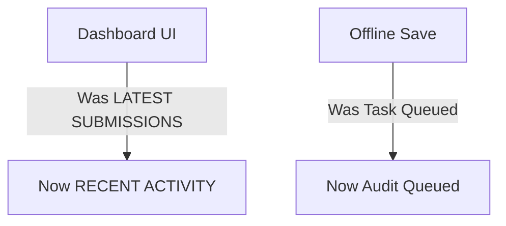

# Task: UX Terminology Standardization
Workflow: /analyze-feature | Track: A

<latent_space_scratchpad>
Target text replacements:
1. `LATEST SUBMISSIONS` -> `RECENT ACTIVITY` (lib/features/dashboard/pages/widgets/submission_feed_section.dart)
2. `Task queued — will sync when online` -> `Audit queued — will sync when online` (lib/features/programs/pages/program_execution_page.dart)
3. `RECENT SCANS` -> `RECENT AUDITS` (comments in lib/_shared/widgets/section_header.dart)
All changes are visual/textual. Risk is effectively zero.
</latent_space_scratchpad>

## Input Lineage
- **Source Input**: User request to fix confusing terminology (Submission, Task, Scan).

## Executive Summary & Out of Scope
Standardizing confusing terminology across the UI. Changing "LATEST SUBMISSIONS" to "RECENT ACTIVITY", standardizing offline toasts from "Task queued" to "Audit queued", and removing mentions of "Scan" in UI components.
**Out of Scope**: 
- Renaming backend tables or models (`cached_submissions`, `SubmissionManager`).
- Renaming template types (e.g., `Task Force` category or `Checklist` scoring mode).
- Renaming Action Plans tab (`PLANS`).

## Risk Assessment
Risk is very low. These are textual UI changes only with no logic changes. No impact on backward compatibility.

## Verification Plan
1. Launch app and navigate to dashboard, verify "RECENT ACTIVITY" header.
2. Complete an audit offline and verify the toast says "Audit queued".
3. Check `lib/_shared/widgets/section_header.dart` comments have no mention of "SCANS".

## System Context
- **Environment**: Flutter offline-first client.
- **RBAC**: No permissions changes. Applies to all users who see the dashboard and execute offline audits.

## Lifecycle Context
- **Success/Sync State**: Toasts will display consistent domain language ("Audit") during offline queuing.
- **Empty/Populated State**: The dashboard section header will correctly reflect that it shows "Activity" (drafts, scheduled, and completed), not just "Submissions".

## Test Contracts
| ID | Exact Text | State Matrix | Why it fails first |
|---|---|---|---|
| TC1 | Dashboard Header is `RECENT ACTIVITY` | Success/Empty | UI currently says `LATEST SUBMISSIONS` |
| TC2 | Offline Sync Toast is `Audit queued...` | Offline Success | UI currently says `Task queued...` |

## Test Fixture & Payloads
- Not applicable (UI textual changes only).

## Tools & Commands
- `flutter test` to ensure no UI snapshot tests are broken (if any exist).

## Proposed Changes
- **[MOD]** `lib/features/dashboard/pages/widgets/submission_feed_section.dart` - Change header text.
- **[MOD]** `lib/features/programs/pages/program_execution_page.dart` - Change toast text.
- **[MOD]** `lib/_shared/widgets/section_header.dart` - Change example comments.

## Concept Diagram

## Execution Slices
### Execution Phase
**Plain English Summary**: Update the 3 identified strings in the Flutter UI to use the new standardized terminology.
**Value Delivered**: Reduces user confusion by ensuring terms match their actual context (Activity Feed vs raw Submissions, Audit vs Task).
**Entry State Required**: Existing UI text.
**Exit State Guaranteed**: New standardized UI text.
**Scope**: 3 file modifications.
**Acceptance Criteria**:
- Header in `submission_feed_section.dart` is `RECENT ACTIVITY`.
- Toast in `program_execution_page.dart` is `Audit queued — will sync when online`.
- Comments in `section_header.dart` reference `RECENT AUDITS` instead of `RECENT SCANS`.

**Complexity**: Low (String replacements only).
**Pros & Cons**: 
- *Pros*: Simple, immediate value, no behavioral changes.
- *Cons*: None.

<command_logs>
- grep_search for 'LATEST SUBMISSIONS|Task queued|RECENT SCANS'
</command_logs>

## Handoff Block
> [!IMPORTANT]
> To execute this plan, run the following command:
> 
> **Route 2: Visuals/Simple (Direct Build)**
> @[/implement] Execute build for Execution Phase: C:\Users\HP\Documents\GitHub\Checkly\docs\architecture\implementation_plan_20260509_110820_ux-term.md
