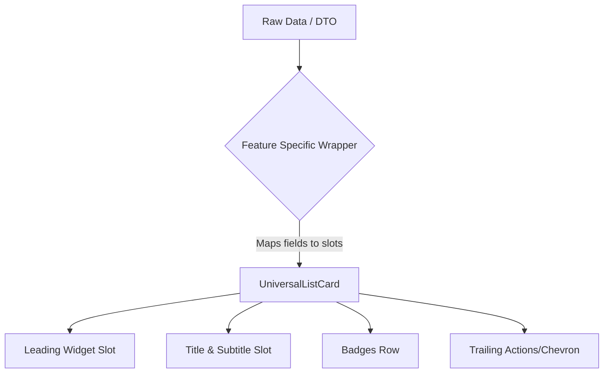

<latent_space_scratchpad>
Constraints:
- Must replace 11 fragmented cards (ActionPlanCard, StoreCard, UserCard, TemplateCard, SubmissionRow, AuditCard, ReviewCard, ActivityCard, LogCard, RiskCard, UserGroupTile).
- Must enforce correct typography hierarchy (titleSmall / titleMedium) using `theme.textTheme`.
- Must centralize date formatting using `date_format_utils.dart`.
- Must standardize leading icons (PastelAvatar, Icon Container).
- Must standardize action placement (Chevron or 3-dot PopupMenuButton).
- Error handling inside cards (like TemplateCard delete) needs to use standard `ErrorDisplayService` without arbitrary "restart app" messages.
</latent_space_scratchpad>

## Input Lineage
C:\Users\HP\.gemini\antigravity\brain\11d63259-2cfc-4b43-aaa5-2e31dccef5fc\ui_inconsistency_report.md

## Executive Summary & Out of Scope
**Summary**: The app currently suffers from a "fragmented card crisis," where 11 different list item cards implement their own layout, typography, date formatting, and icon styling from scratch. This plan dictates the creation of a `UniversalListCard` primitive that forces consistency, followed by a phased migration of all existing cards to this new primitive.

**Out of Scope**: 
- Changing any backend DTOs or database logic.
- Adding new features to these cards. We are strictly standardizing their visual appearance and layout.

## Risk Assessment
The blast radius of this change is HIGH. It touches the UI of almost every major list in the app. Visual regression testing must be performed. Logic bugs are low risk, but layout breaking is high risk.

## Verification Plan
1. Run `flutter test` to ensure all existing widget tests for these components pass.
2. Manually or visually inspect Storybook / main app screens to verify no layout overflow occurs.

## System Context
- **Environment**: Flutter offline-first UI.
- **Components**: Primitive widgets (`StrokeCard`, `PillChip`, `PastelAvatar`).
- **Dependencies**: Uses `date_format_utils.dart` for all time interpolations.

## Lifecycle Context
- **Success**: Displays the standardized card with appropriate leading icon, text, badges, and trailing actions.
- **Error**: N/A for the primitive itself. Interactive errors (like deletion failure) map to `ErrorDisplayService`.
- **Empty**: N/A.
- **Loading**: N/A.

## Constraint Traceability
| Constraint | Source | Test Contract ID |
|---|---|---|
| Must enforce typography hierarchy | Inconsistency Report | ULC-UI-01 |
| Must use central date formatting | Inconsistency Report | ULC-UI-02 |
| Must standardize leading icon | Inconsistency Report | ULC-UI-03 |
| Must support PopupMenu or Chevron | Inconsistency Report | ULC-UI-04 |

## Test Contracts
| ID | Contract Text | State Matrix | Why it fails first |
|---|---|---|---|
| ULC-UI-01 | `UniversalListCard` title strictly uses `theme.textTheme.titleMedium` or `titleSmall` | Success | Custom hardcoded `TextStyle` was previously used. |
| ULC-UI-02 | Date representations strictly pipe through `date_format_utils.dart` | Success | Manual string interpolation previously used. |
| ULC-UI-03 | Left side avatar/icon slot adheres to consistent boundary sizes | Success | Arbitrary `CircleAvatar` or `Container` sizes were used. |
| ULC-UI-04 | Interactive cards properly render a chevron or 3-dot menu | Success | Actions were placed arbitrarily. |

## Test Fixture & Payloads
- **Required Setup**: Visual inspection of Storybook/Widgetbook or manual testing of Admin/Audit lists.

## Tools & Commands
- **Skills Required**: `flutter-api`, `flutter-architecture`, `ui-visual-validator`.
- **Verification Command**: `flutter test` (to ensure layout assertions pass).

## Proposed Changes
| Component | Truncation Limit | Overflow Action | Required New Route |
|---|---|---|---|
| `UniversalListCard` Title | 1-2 lines | `TextOverflow.ellipsis` | N/A |
| `UniversalListCard` Subtitle | 1-2 lines | `TextOverflow.ellipsis` | N/A |

**[NEW]** `lib/_shared/widgets/primitives/universal_list_card.dart`
**[MOD]** `lib/features/admin/pages/widgets/store_card.dart`
**[MOD]** `lib/features/admin/widgets/user_card.dart`
**[MOD]** `lib/features/user_groups/widgets/user_group_tile.dart`
**[MOD]** `lib/features/dashboard/pages/widgets/submission_row.dart`
**[MOD]** `lib/features/audit/widgets/audit_card.dart`
**[MOD]** `lib/features/admin/pages/widgets/review_card.dart`
**[MOD]** `lib/features/profile/widgets/activity_card.dart`
**[MOD]** `lib/features/action_plans/widgets/action_plan_card.dart`
**[MOD]** `lib/features/templates/widgets/template_card.dart`
**[MOD]** `lib/features/admin/widgets/log_card.dart`
**[MOD]** `lib/features/admin/pages/widgets/risk_card.dart`

## Concept Diagram

## Execution Slices

### Slice 1: The Core Primitive
**Plain English Summary**: Create the reusable `UniversalListCard` primitive that accepts slots for leading widget, title, subtitle, trailing, and badges.
**Value Delivered**: Centralizes layout, typography, and styling logic into one verifiable file.
**Entry/Exit State**: Primitive exists in `lib/_shared/widgets/primitives/`.
**Scope**: 1 new file.
**Acceptance Criteria**: Must wrap `StrokeCard`, implement proper padding, typography mapping, and strict slots.
**Complexity**: Low. Isolated UI component.

### Slice 2: Admin & User Entities
**Plain English Summary**: Refactor `StoreCard`, `UserCard`, and `UserGroupTile` to use `UniversalListCard`.
**Value Delivered**: Unifies the Admin section UI.
**Entry/Exit State**: Admin lists render identically but utilize the new primitive.
**Scope**: 3 files modified.
**Acceptance Criteria**: Hardcoded styles removed, hierarchy fixed, existing widget tests pass.
**Complexity**: Medium. Requires careful mapping of DTO fields to the universal slots.

### Slice 3: Audit & Plan Entities
**Plain English Summary**: Refactor `SubmissionRow`, `AuditCard`, `ReviewCard`, `ActivityCard`, and `ActionPlanCard` to use `UniversalListCard`.
**Value Delivered**: Unifies the core business flows.
**Entry/Exit State**: Audit lists render identically but utilize the new primitive. Date formatting bugs resolved.
**Scope**: 5 files modified.
**Acceptance Criteria**: Hardcoded styles removed, dates use `date_format_utils`, existing widget tests pass.
**Complexity**: Medium. High visibility components.

### Slice 4: System & Template Entities
**Plain English Summary**: Refactor `TemplateCard`, `LogCard`, and `RiskCard`.
**Value Delivered**: Finishes the migration of all list items.
**Entry/Exit State**: Settings and Log lists render consistently.
**Scope**: 3 files modified.
**Acceptance Criteria**: Hardcoded styles removed, generic error dialogs in `TemplateCard` replaced with standard errors.
**Complexity**: Low.

## Handoff Block
- **Slice 1**: Plan -> Build
- **Slice 2**: Plan -> Build
- **Slice 3**: Plan -> Build
- **Slice 4**: Plan -> Build

Execute these phases ONE AT A TIME. Wait for user confirmation after each slice.
Plan Location: `c:\Users\HP\Documents\GitHub\Checkly\docs\architecture\implementation_plan_20260522_221500_uxe2_universal_list_card.md`
