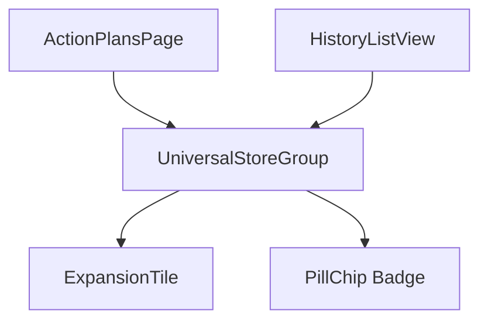

<latent_space_scratchpad>
- Extracting the mapping logic from the feature-specific StoreGroups to their parents keeps the components pure primitives.
- Using `PillChip` will ensure standard gamified styling for the count badges.
- Blast radius is low to medium: changes the look of two screens but removes redundant implementations.
</latent_space_scratchpad>

## Input Lineage
- c:\Users\HP\Documents\GitHub\Checkly\docs\diagnostics\failure_report_20260522_224900_uxe3_group_headers.md

## Executive Summary & Out of Scope
The Checkly UI has two duplicate `StoreGroup` implementations (`audit` and `action_plans`) which have drifted visually. This plan consolidates them into a single `UniversalStoreGroup` shared primitive that adopts the "Deep Spirit" gamified aesthetic, resolving the inconsistency crisis for group headers.

**Out of Scope**: 
- Modifying the interior card contents (already addressed by `UniversalListCard`).
- Altering the backend API structure.
- Replacing group headers outside of Audit and Action Plan domains if they do not exist.

## System Context
- **Offline/Online**: N/A (UI layer only).
- **APIs**: N/A.
- **RBAC**: N/A.
- **Logs**: N/A.

## Lifecycle Context
- **Success**: The `ExpansionTile` headers load with matching Gamified text and standard `PillChip` counters.
- **Error/Empty/Loading**: Not applicable to the header itself, handled by parent containers.

## Constraint Traceability
| Constraint | Test Contract ID |
| --- | --- |
| Create `StoreGroupHeader` primitive | AP-UX-01 |
| Apply "Deep Spirit" gamified typography | AP-UX-02 |
| Delete duplicated implementations | AP-UX-03 |

## Test Contracts
| ID | Contract | State | Why it fails first |
| --- | --- | --- | --- |
| AP-UX-01 | `UniversalStoreGroup` must exist and take `children` | Success | Doesn't exist yet |
| AP-UX-02 | Must use `PillChip` for counter | Success | The old headers used custom containers |
| AP-UX-03 | Codebase must not contain `features/audit/widgets/store_group.dart` | N/A | Still present |

## Test Fixture & Payloads
- Requires standard Flutter widget testing environment.

## Tools & Commands
- `flutter test`
- `flutter analyze`

## Proposed Changes
| Action | File | Description |
| --- | --- | --- |
| `[NEW]` | `lib/_shared/widgets/primitives/universal_store_group.dart` | The new shared group header. |
| `[DEL]` | `lib/features/action_plans/widgets/store_group.dart` | Deleted duplicate. |
| `[DEL]` | `lib/features/audit/widgets/store_group.dart` | Deleted duplicate. |
| `[MOD]` | `lib/features/action_plans/pages/action_plans_page.dart` | Map the children list here and use `UniversalStoreGroup`. |
| `[MOD]` | `lib/features/audit/pages/widgets/history_list_view.dart` | Map the children list here and use `UniversalStoreGroup`. |

### UI Component Truncation
| Component | Truncation Limit | Overflow Action | Required Route |
| --- | --- | --- | --- |
| `UniversalStoreGroup` | 1 line for storeName | Ellipsis | N/A |

## Risk Assessment
- **Risk**: Low. This is purely a UI refactor.
- **Mitigation**: Using Flutter's existing `Theme` system and ensuring padding maps closely to what was there before. The component relies only on standard Flutter primitives (`ExpansionTile`, `Row`, `Text`, `PillChip`). No API or data models are affected.

## Verification Plan
1. Ensure the `flutter test` command runs and passes without any analyzer warnings.
2. Verify that both the Action Plans tab and the History (Audits) tab render the `UniversalStoreGroup` correctly.
3. Confirm that the store names are in `Nunito` font, uppercase, with the standard gamified `PillChip` badge beside them.

## Concept Diagram

## Execution Slices

### Execution Phase
- **Plain English Summary**: Create the universal primitive, inject it into the Action Plans and Audits lists, and delete the redundant implementations.
- **Value Delivered**: Visual consistency across group headers.
- **Entry State**: Two duplicate widgets.
- **Exit State**: One unified primitive.
- **Scope**: `_shared/widgets/primitives`, `action_plans`, `audit`.
- **Acceptance Criteria**: Both `action_plans_page.dart` and `history_list_view.dart` map their `List` to widgets and pass them to `UniversalStoreGroup`. The old files are deleted. No analyzer warnings.
- **Complexity**: Low. Safe refactor that just shuffles widget trees.

## Handoff Block
- **Execution Phase**: Plan -> Build

Absolute Path: `c:\Users\HP\Documents\GitHub\Checkly\docs\architecture\implementation_plan_20260522_225200_uxe4_universal_group_header.md`
