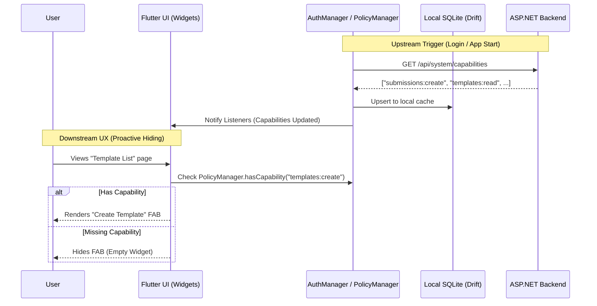

# Research: UI PBAC Capability Mapping

## [ORIGIN_IDEA]
The user observed that backend permission blocks (403 errors) create bad UX when a user clicks a button they shouldn't have access to. The UI needs to be "dumb" and strictly read PBAC capabilities to proactively hide/show controls, preventing unauthorized actions at the UI level before the backend ever rejects them.

<latent_space_scratchpad>
**Reasoning & Tradeoffs:**
- Current Reality: The app has `PolicyManager`, `PermissionGuard`, and `AuthManager.capabilities`. The infrastructure exists.
- The gap: Many UI features might still be hardcoding role checks (e.g., `user.role == 'admin'`) instead of capability checks (`hasCapability('submissions:create')`), or simply forgetting to wrap sensitive action buttons.
- Target Architecture: Every navigation item, Floating Action Button (FAB), and edit/delete dropdown must be wrapped in `PermissionGuard` or a functional equivalent.
- E2E Flow: Backend assigns Capabilities to Roles -> UI fetches at Login via `/system/capabilities` -> UI caches in SQLite -> UI renders dynamically based on current memory state of capabilities.
- Complex Scenarios: 
  - Routing: If you navigate directly to `/programs/new` and lack `programs:create`, the router must kick you out (currently handled in AppRouter via `PolicyManager`).
  - Forms: Creating a new audit. If you lack `submissions:create`, the "New Audit" button should completely vanish.

**NFR Blind Spots:**
1. Memory / Render overhead: Wrapping every single UI button in `ValueListenableBuilder` (via `PermissionGuard`) could trigger unnecessary rebuilds.
2. Capability Sync Lag: If an Admin revokes a capability mid-session, the UI won't know until the next `/system/capabilities` sync, leading to a 403. UI must still elegantly handle 403s.
3. Offline State: If the user is offline, the UI must rely entirely on the Drift cached capabilities.

</latent_space_scratchpad>

## E2E Workflow Map

### Context Handoff Points
1. **Server -> Client**: The `/api/system/capabilities` endpoint dictates exactly what the UI can render.
2. **Local Cache -> Memory**: `AuthManager` loads from SQLite on cold boot to ensure offline resilience.
3. **Memory -> UI**: `PermissionGuard` reads from `PolicyManager` to dynamically slice the widget tree.

## Impact Spectrum

| Strategy | Description | Pros | Cons |
|----------|-------------|------|------|
| **(A) Strict Native Fit (Capability Wrapping)** | Wrap every sensitive Widget in `PermissionGuard`. Router guards routes via `PolicyManager`. | Utilizes existing custom-built `PermissionGuard` and `PolicyManager`. Zero external dependencies. High cohesion. | Verbose UI code. Developers must remember to wrap every new button. |
| **(B) Pragmatic Balance (Role + Capability)** | Check roles for macro-features (e.g., "Is Manager Dashboard?"), but capabilities for micro-actions (e.g., "Can Edit?"). | Easier to write UI layouts based on personas. | Anti-pattern to PBAC. Creates split-brain logic and maintenance nightmares when roles change. |
| **(C) Enterprise Overhaul (Server-Driven UI)** | Backend returns the exact JSON layout of buttons/menus to render based on the user's role. | 100% secure. UI doesn't need to know about PBAC. | Massive refactor of the Flutter codebase. Requires breaking offline-first support. |

## Conflicts with Rules
- If we do Option B, it violates the Checkly PBAC golden rule of "capabilities over roles".
- Doing Option A requires wrapping logic, which slightly increases widget nesting, but `PermissionGuard` handles this elegantly without bloating file size too heavily.

**Selected Strategy:** Option (A). Strict Native Fit. Checkly's architecture (`flutter_it`, `PolicyManager`, `PermissionGuard`) was explicitly designed for this.

## Implementation Blueprint (UI Capability Map)

The following UI components must be audited and migrated to check specific capabilities:

1. **Dashboard / Navigation**
   - Main Shell Tabs: Hide "Programs" tab if lacking `programs:read`.
   - Main Shell Tabs: Hide "Templates" tab if lacking `templates:read`.

2. **Template Management**
   - "New Template" FAB -> Requires `templates:create`.
   - "Edit Template" action -> Requires `templates:update`.
   - "Delete Template" action -> Requires `templates:delete`.

3. **Program/Assignment Management**
   - "Create Program" FAB -> Requires `programs:create`.
   - Dropdown: "Assign to Auditor" -> Only list users possessing `submissions:execute`.

4. **Audits / Submissions**
   - "Start Audit" / "New Submission" FAB -> Requires `submissions:create`.
   - "Submit / Finalize" Action -> Handled contextually (requires `submissions:execute` and ownership/delegate validation).

<forensic_evidence>
- Ran `grep_search` across `lib/` for `capabilities` and `role`. Found that the PBAC foundation is already robustly built via `PolicyManager.dart`, `AuthManager.dart`, and `PermissionGuard.dart`.
- The backend API (`/api/system/capabilities`) correctly feeds the frontend.
</forensic_evidence>

## Handoff Block
- **Verdict**: Viable. The UI PBAC infrastructure is already present in `PolicyManager` and `PermissionGuard`. The gap is purely implementation coverage across screens.
- **Effort Sizing**: Track A (Standard Implementation). Easily parallelized screen-by-screen.
- **AI Agent Mission Brief**: Audit the main Flutter feature screens (Templates, Programs, Submissions) and replace any hardcoded `user.role == '...'` checks with `PermissionGuard(capability: AppCapabilities.xyz)` to proactively hide unauthorized buttons.
- **Next Command**: `@[/analyze-feature] docs/product/research_20260510_172009_uicaps_ui-capability-mapping.md`
