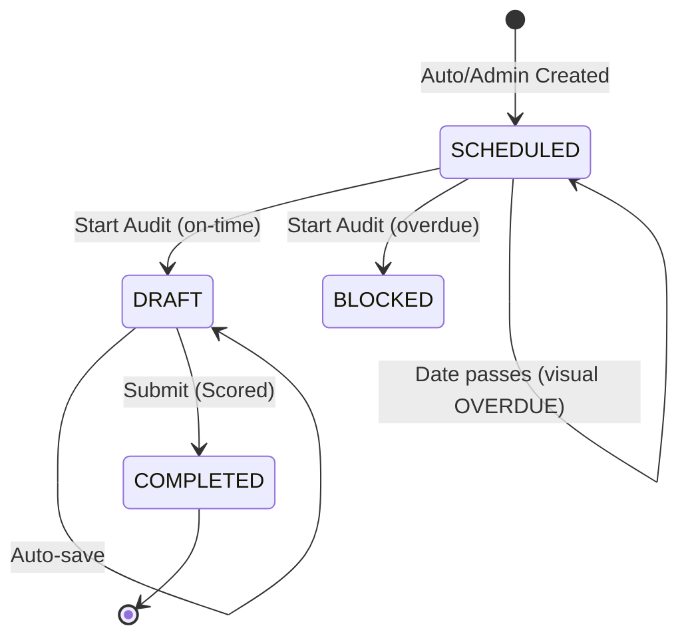
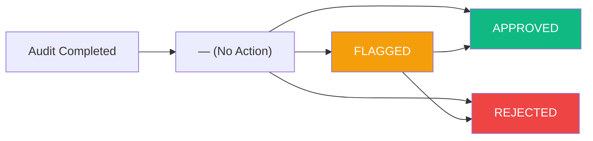
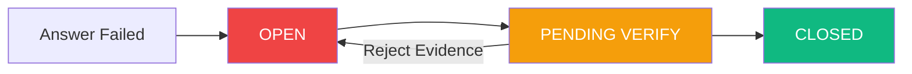

# Core Project Context: Workflows & States

> This document defines the canonical state machines for Audits and Action Plans, including UI mappings and role contexts.

> [!NOTE]
> **Platform**: Flutter mobile (`lib/features/audit/`) is the primary client. PWA (`checkly-smart/`) references below are legacy. Server API is ASP.NET Core 10 (`server/`).

---

## 1. Audit Lifecycle (Primary)

The audit lifecycle tracks the progress of a submission from scheduling to final completion.

### State Definitions

| Key | UI Label | UI Color | Dashboard | Allowed Roles | Context |
|:---|:---|:---|:---|:---|:---|
| `scheduled` | **SCHEDULED** | Gray | Todo | Auditor | Assigned but not yet started. |
| `scheduled` (overdue) | **OVERDUE** | Red | Todo (sorted to top) | Auditor | `scheduled_at::date < today`. Cannot be started. |
| `draft` | **DRAFT** | Blue | Doing | Auditor | In-progress. Can be resumed. |
| `completed` | **COMPLETED** | Green | Done | Read Only | Scored. Triggers action plans. |

> [!WARNING]
> **Overdue audits are blocked.** Navigating to `/audit/{id}` for an overdue scheduled audit shows a full-screen "This Audit Has Expired" block screen. The audit stays in `scheduled` status permanently.

---

## 2. Audit Review Disposition

Independent from the primary lifecycle, the review disposition runs in parallel after an audit is completed.

### Review State Definitions

| Key | UI Label | UI Color | Transition From | Allowed Roles | Context |
|:---|:---|:---|:---|:---|:---|
| `null` | **—** | Default | — | — | No review action taken. |
| `flagged` | **FLAGGED** | Amber | `null` | System Auto | Flagged for Admin review (e.g., GPS violation). |
| `approved` | **APPROVED** | Emerald | `null`, `flagged` | Admin | Final confirmation. Score counted. |
| `rejected` | **REJECTED** | Red | `null`, `flagged` | Admin | Final. Score **EXCLUDED** from metrics. |

> [!WARNING]
> **REJECTED** status excludes the audit score from all dashboard metrics and reporting.

---

## 3. Action Plan Workflow

Corrective tasks generated from non-conformities (failed answers) in a completed audit.

### Action Plan States

| Key | UI Label | UI Color | Dashboard | Allowed Roles | Context |
|:---|:---|:---|:---|:---|:---|
| `open` | **OPEN** | Red | Open | Store Manager | SM must fix and submit evidence. |
| `pending_verify` | **PENDING VERIFY** | Amber | Verify | AM, Admin | Evidence review required to close. |
| `closed` | **CLOSED** | Green | Done | Read Only | Issue resolved. Immutable. |

### Automated Notifications (DB Triggers)

Notifications are generated server-side by `handle_action_plan_status_change()` trigger:

| Transition | Type | Recipients | Message |
|:---|:---|:---|:---|
| `open` → `pending_verify` | `action_plan_evidence_submitted` 📸 | Auditor + AM | Evidence submitted for [criteria] at [store] |
| `pending_verify` → `closed` | `action_plan_closed` ✅ | Current SM | Action plan verified and closed |
| `pending_verify` → `open` | `action_plan_rejected` 🔄 | Current SM | Evidence rejected, please resubmit |

> [!NOTE]
> All recipient lookups are **live** (current SM/AM), not historical snapshots.

### Deadline Reminder (Scheduled Job)

`send_deadline_reminders()` runs daily via `pg_cron` at **1:00 AM UTC** (8:00 AM ICT):
- Groups open APs by submission and checks template's `action_plan_reminder_days` window
- Sends one batched `deadline_reminder` ⏰ notification per audit to the current SM
- **Dedup**: Only one reminder per submission (via `notifications.metadata->>'source_submission_id'`)

### Schedule Reminder (Scheduled Job)

`send_schedule_reminders()` runs daily via `pg_cron` at **1:05 AM UTC** (8:05 AM ICT):
- Finds scheduled audits where `scheduled_at::date = CURRENT_DATE + 1` (tomorrow)
- Sends `schedule_reminder` ⏰ notification to the assigned `auditor_id`
- **Dedup**: Only one reminder per submission (via `notifications.metadata->>'source_submission_id'`)
- **Skip**: Submissions without `auditor_id` are skipped

### Time-Based Flags

| Flag | Trigger | UI Impact |
|:---|:---|:---|
| **OVERDUE** | `status == 'open' AND deadline < NOW()` | Forced Red color & Priority sorting. |

---

## 4. Configuration Standards

| Feature | Source | Default | Range |
|:---|:---|:---|:---|
| Action Plan Deadline | `scoring_logic_config.features.action_plan_deadline_days` | 7 Days | 1-90 Days |
| Deadline Reminder | `scoring_logic_config.features.action_plan_reminder_days` | 2 Days | 1-30 Days |

> [!NOTE]
> Both are configurable per template within the Template Builder. The reminder fires X days **before** the deadline.

---

## 5. Action Plan Creation Rules

When a submission status changes to `completed`, the DB trigger `handle_submission_completion` auto-creates one action plan **per failed answer** (`answers.value = 'fail'`).

- **Condition**: `answer.value = 'fail'` (all fails, not just CCP/RISK)
- **Idempotency**: Skips if action plans already exist for that submission
- **Deadline**: `NOW() + N days` where N = `template.scoring_logic_config.features.action_plan_deadline_days` (default: 7)
- **Snapshots**: `store_name`, `store_manager_name`, `criteria_label`, `group_title` (path via recursive CTE)

---

## 5.5. Score Verification Pipeline

Server-side re-computation of audit scores to detect tampering (spoofed `p_total_score` in `finalize_audit`).

### Phase 1: Observe (Async, Fire-and-Forget)
- **Trigger**: `handle_submission_completion` calls `net.http_post()` (pg_net) to `verify-score` Edge Function
- **Timing**: After submission status update (non-blocking)
- **On mismatch >5%**: Logs `SCORING_MISMATCH` to `system_logs`
- **On match**: No action

### Phase 2: Enforce (Synchronous, Blocking)
- **Location**: Inside `finalize_audit` RPC, between answer upsert and submission UPDATE
- **Method**: `extensions.http_post()` (synchronous HTTP extension)
- **On mismatch >5%**: `RAISE EXCEPTION` → submission rejected, `SCORING_MISMATCH_REJECTED` logged
- **On match**: Proceeds to UPDATE
- **Fail-open**: Network/timeout errors do NOT block submissions

### Kill Switch (Vault)

| Secret | Value | Behavior |
|:---|:---|:---|
| `score_verification_mode` | `observe` | Phase 1 only (log, never block) |
| `score_verification_mode` | `enforce` | Phase 2 (block + reject mismatches) |

### Technical References
- **Edge Function**: `supabase/functions/verify-score/index.ts` (inlined scoring engine)
- **Phase 1 trigger**: `handle_submission_completion` (pg_net async)
- **Phase 2 RPC**: `finalize_audit` (http extension sync)
- **Extensions**: `pg_net` (async), `http` (sync)

---

## 6. Impact on Dashboard Statistics

> [!IMPORTANT]
> **Action plans do NOT affect audit scores.** The `submissions.total_score` is permanently set at finalization. Action plans only affect the metrics below.

| Dashboard | Metric | Source |
|:----------|:-------|:-------|
| **Admin** | `totalOpenAPs` | Count of `action_plans` where `status = 'open'` |
| **Admin** | `overdueActionPlans` | Subset of open APs where `deadline < now` |
| **Admin** | `overdueScheduled` | Count of `submissions` where `status = 'scheduled' AND scheduled_at::date < today` |
| **SM** | `openFixes` | Count of non-closed APs for store (`status != 'closed'`) |
| **SM** | `overdueFixes` | Subset where `deadline < now` |
| **SM** | `nearestDeadline` | Earliest upcoming deadline |
| **Actions Page** | Metrics by status | Independent counts from `action_plans` table |

### Technical References
- **Creation trigger**: `handle_submission_completion` (DB function on `submissions`)
- **Status change trigger**: `handle_action_plan_status_change` (DB function on `action_plans`)
- **Service layer**: [actionPlanService.ts](file:///c:/Users/HP/Documents/GitHub/checkly-smart/src/entities/action-plan/api/actionPlanService.ts)
- **Dashboard analytics**: [analyticsService.ts](file:///c:/Users/HP/Documents/GitHub/checkly-smart/src/entities/analytics/api/analyticsService.ts) — `getAdminKPIs()`, `getStoreManagerKPIs()`

---

## 7. Offline & Sync Architecture

The app is designed for field auditors with unreliable connectivity. Users must **log in while online**, then can work offline for the remainder of their session.

### Storage Layers

| Layer | Technology | What It Stores | Cleared on Logout? |
|:------|:-----------|:---------------|:-------------------|
| **Outbox** | IndexedDB (Dexie) | Queued submissions & photos | ❌ No — survives logout |
| **Drafts** | localStorage | In-progress audit answers, template drafts | ❌ No |
| **Query Cache** | localStorage (`checkly-query-cache`) | Cached API responses (templates, stores, submissions) | ✅ Yes |
| **Auth Session** | localStorage | Cached role/status for instant remount | ✅ Yes |

### What Works Offline

| Feature | How |
|:--------|:----|
| App loads | Service Worker (Workbox) caches all JS/CSS/HTML bundles |
| Start a new audit | Templates + stores cached with `gcTime: Infinity` |
| Fill in answers | Draft saved to localStorage via `useAuditDraft` |
| Submit audit | Queued to Dexie outbox with `_queued` flag |
| Take photos | Saved to Dexie `photos` table |

### What Requires Internet

Login, logout, viewing new notifications, uploading evidence photos, accessing data never previously cached.

### Sync Engine (`syncEngine.ts`)

When connectivity returns:
1. **Heartbeat check** — pings server (protects against captive portals / liar-fi)
2. **FIFO processing** — outbox mutations processed in order
3. **Same API** — uses same RPCs as online paths (e.g., `finalize_audit`)
4. **Auth-aware** — pauses if session is expired, resumes after refresh

> [!IMPORTANT]
> **Offline data is never deleted by the app.** Queued submissions survive logout, token expiry, and even 7+ days offline. They sync when the user goes online and logs in.

---

## 8. Cache Strategy

React Query manages server state with an **offline-first** approach (`networkMode: 'offlineFirst'`).

### Cache Lifecycle

| Event | Behavior |
|:------|:---------|
| **Login** | `queryClient.invalidateQueries()` — forces fresh data fetch |
| **Tab switch** | `refetchOnWindowFocus: true` — refetches stale queries on return |
| **Background** | Queries refetch based on per-entity `staleTime` |
| **Logout** | `clearUserCache()` — clears React Query cache + localStorage persisted cache |

### Per-Entity Freshness

| Query Key | staleTime | gcTime | Rationale |
|:----------|:----------|:-------|:----------|
| `templates` | 5 min (default) | ∞ | Reference data, rarely changes, critical for offline |
| `stores` | 5 min (default) | ∞ | Reference data, rarely changes, critical for offline |
| `notifications` | 2 min | default | Should feel responsive but not excessive |
| `audit-metrics` | 10 min | default | Mutation-driven invalidation covers own writes |
| `submissions` | 10 min | default | Mutation-driven invalidation covers own writes |
| `action-plans` | 10 min | default | Mutation-driven invalidation covers own writes |

### Technical References
- **Query client config**: [queryClient.ts](file:///c:/Users/HP/Documents/GitHub/checkly-smart/src/lib/queryClient.ts)
- **Cache cleanup**: `clearUserCache()` in `queryClient.ts`
- **Auth integration**: [useAuth.tsx](file:///c:/Users/HP/Documents/GitHub/checkly-smart/src/hooks/useAuth.tsx) — calls `clearUserCache()` on logout, `invalidateQueries()` on login

---

## 9. App Lifecycle Manager

Manages session recovery when the app resumes from background, based on how long the user was away.

### Recovery Tiers

| Tier | Duration | Action | User Impact |
|:-----|:---------|:-------|:------------|
| **0** | < 5 min | No-op | None — instant resume |
| **1** | 5 min – 12 hrs | Silent auth check + selective query invalidation | None — refreshes only stale data |
| **2** | 12 hrs – 7 days | Full recovery — re-validates session, refreshes profile, invalidates all queries | Brief loading possible |
| **3** | > 7 days | Redirect to login page | User must log in again |

### Key Rules
- **Never blocks UI** — user always sees last-known screen during recovery
- **Network-aware** — skips recovery calls when offline
- **Debounced** — 500ms debounce prevents rapid toggles (Android pattern)
- **JWT expiry**: Access token lasts **24 hours** — covers a full work day without token renewal

### Technical References
- **Hook**: [useAppLifecycle.ts](file:///c:/Users/HP/Documents/GitHub/checkly-smart/src/hooks/useAppLifecycle.ts)
- **Mounted in**: `AppContent` (single instance)

---

## 10. Entity Activity History

The system tracks key actions (SM transfers, user edits, store changes) via `system_logs` and surfaces them in two places:

### Admin View (Embedded in Edit Dialogs)
- **Component**: [EntityActivityLog.tsx](file:///c:/Users/HP/Documents/GitHub/checkly-smart/src/components/admin/EntityActivityLog.tsx)
- **Where**: Edit Store dialog, Edit User dialog (as an accordion)
- **Data**: Queries `system_logs` filtered by `entity_type` + `entity_id`

### Self-History (All Roles)
- **Page**: [ActivityHistory.tsx](file:///c:/Users/HP/Documents/GitHub/checkly-smart/src/pages/ActivityHistory.tsx) at `/activity`
- **Data**: Queries `view_system_logs_with_users` (RLS-filtered to current user)
- **Features**: Client-side search, progressive pagination, detail sheet

### Technical References
- **Service**: [systemLogService.ts](file:///c:/Users/HP/Documents/GitHub/checkly-smart/src/entities/notification/api/systemLogService.ts) — `getEntityLogs()`, `getMyActivityLogs()`
- **Menu**: Profile page → "My Activity" menu item (all roles)
- **Preloading**: `useRoutePreloader.ts` includes `ActivityHistory` for all 4 roles
